

## About me

I'm Gautam, a B.Tech Artificial Intelligence student at SVNIT Surat. I enjoy building software that works end to end: an API, the data behind it and an interface on top. Most of my time goes into backend and full-stack projects, and into solving data structures and algorithms problems in C++.

I also make games. My indie game, [The Third Direction](https://gautam-jain.itch.io/the-third-direction), is published on itch.io.

## Current focus

- **[CloudForge](https://github.com/Gautam-eng19/CloudForge)**: a mini cloud platform I'm building from scratch to learn how cloud systems work. Right now it is an Express REST API.
- **[TaskForge](https://github.com/Gautam-eng19/TaskForge)**: a productivity app. The dashboard interface is built in HTML and CSS, and the logic is next.
- **DSA in C++**: adding to [leetcode-solutions](https://github.com/Gautam-eng19/leetcode-solutions), one topic at a time.
- **Learning**: cloud computing fundamentals.

## Technical skills

<!-- skills:start -->

<table>
<tr>
<td><b>Languages</b></td>
<td>

</td>
</tr>
<tr>
<td><b>Frontend</b></td>
<td>

</td>
</tr>
<tr>
<td><b>Backend</b></td>
<td>

</td>
</tr>
<tr>
<td><b>Databases</b></td>
<td>

</td>
</tr>
<tr>
<td><b>Tools</b></td>
<td>

</td>
</tr>
<tr>
<td><b>Concepts</b></td>
<td>

</td>
</tr>
</table>

<!-- skills:end -->

## Featured projects

<!-- projects:start -->

<a href="https://github.com/Gautam-eng19/VAANI#gh-dark-mode-only">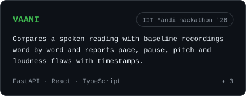</a><a href="https://github.com/Gautam-eng19/VAANI#gh-light-mode-only">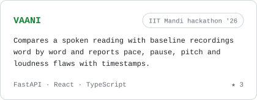</a>
<a href="https://github.com/Gautam-eng19/PARAKH#gh-dark-mode-only"></a><a href="https://github.com/Gautam-eng19/PARAKH#gh-light-mode-only"></a>
<a href="https://github.com/Gautam-eng19/leetcode-solutions#gh-dark-mode-only"></a><a href="https://github.com/Gautam-eng19/leetcode-solutions#gh-light-mode-only"></a>
<a href="https://github.com/Gautam-eng19/CloudForge#gh-dark-mode-only">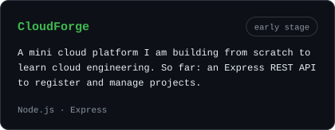</a><a href="https://github.com/Gautam-eng19/CloudForge#gh-light-mode-only">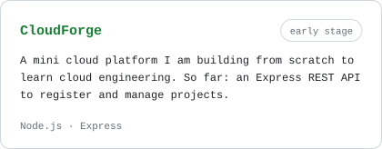</a>
<a href="https://github.com/Gautam-eng19/TaskForge#gh-dark-mode-only"></a><a href="https://github.com/Gautam-eng19/TaskForge#gh-light-mode-only"></a>
<a href="https://github.com/Gautam-eng19/Hindi-Punctuation-Translation#gh-dark-mode-only">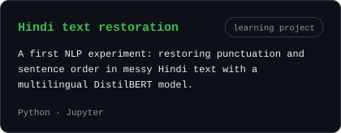</a><a href="https://github.com/Gautam-eng19/Hindi-Punctuation-Translation#gh-light-mode-only">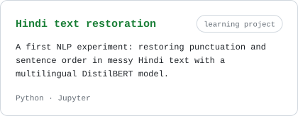</a>

<!-- projects:end -->

## Competitive programming

I solve problems on LeetCode regularly in C++, and publish solutions in a public repository sorted by topic and difficulty.

<picture>
  <source media="(prefers-color-scheme: dark)" srcset="assets/leetcode-dark.svg">
  <source media="(prefers-color-scheme: light)" srcset="assets/leetcode-light.svg">
  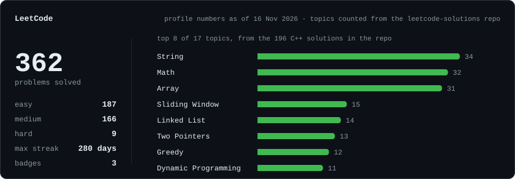
</picture>

<a href="https://leetcode.com/u/gautamjain12/">LeetCode profile</a> · <a href="https://github.com/Gautam-eng19/leetcode-solutions">Solutions repository</a>

## Currently exploring

These are areas I'm learning, not skills I claim yet.

- **Cloud computing**: fundamentals, infrastructure and architecture, and cloud engineering concepts. CloudForge is where I practise.
- **AI and machine learning**: fundamentals.
- **NLP and speech processing**: early experiments, such as the Hindi text restoration project above.
- **LLM applications**.

## GitHub statistics

<picture>
  <source media="(prefers-color-scheme: dark)" srcset="assets/stats-dark.svg">
  <source media="(prefers-color-scheme: light)" srcset="assets/stats-light.svg">
  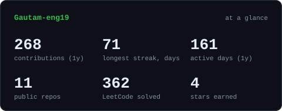
</picture>
<picture>
  <source media="(prefers-color-scheme: dark)" srcset="assets/langs-dark.svg">
  <source media="(prefers-color-scheme: light)" srcset="assets/langs-light.svg">
  
</picture>

## Contribution graph

<picture>
  <source media="(prefers-color-scheme: dark)" srcset="assets/calendar-dark.svg">
  <source media="(prefers-color-scheme: light)" srcset="assets/calendar-light.svg">
  
</picture>

  

<picture>
  <source media="(prefers-color-scheme: dark)" srcset="assets/snake-dark.svg">
  <source media="(prefers-color-scheme: light)" srcset="assets/snake-light.svg">
  
</picture>

## Connect with me

   

  

